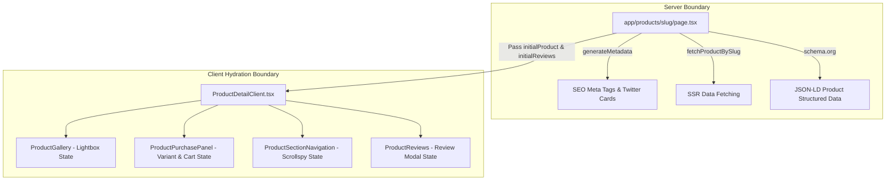

# Frontend Architecture & Component Boundaries

This document defines the **codebase architecture, directory structure, component boundaries, and data flow patterns** for the Next.js 16 frontend application (`frontend/src/`).

---

## 1. Directory Structure & Modular Separation

The codebase follows a strictly organized domain-driven layout:

```text
frontend/src/
├── app/                        # Next.js App Router (Routes & Server Entrypoints)
│   ├── layout.tsx              # Root HTML, fonts (Figtree/Inter), CartProvider, Toaster
│   ├── globals.css             # Tailwind v4 import, theme CSS variables
│   ├── page.tsx                # Homepage route
│   ├── products/[slug]/        # PDP (Server page.tsx + SEO + JSON-LD)
│   ├── collections/[slug]/     # PLP (Catalog & filtering)
│   ├── cart/                   # Shopping cart page
│   ├── checkout/               # Multi-step checkout
│   ├── account/                # Customer portal
│   ├── admin/                  # Protected administrator views
│   └── ...
├── components/                 # Reusable UI & Domain Components
│   ├── ui/                     # Primitives (Button, Dialog, Input, Card, Tabs, Accordion)
│   ├── layout/                 # Layout chrome (Header, Navbar, AnnouncementBar, Footer)
│   ├── product/                # PDP modules (Gallery, PurchasePanel, Overview, Box, Specs, FAQs, Reviews)
│   ├── checkout/               # Checkout modules (CustomerForm, OrderSummary, PaymentMethod)
│   ├── home/                   # Homepage sections (HeroSlider, BentoShowcase, NewsSlider)
│   └── admin/                  # Admin dashboard components
├── context/                    # React Context State Providers
│   └── CartContext.tsx         # Global shopping cart, coupons, totals, and persistence
├── lib/                        # Core Utilities & API Client
│   ├── api.ts                  # Axios instance, endpoints, JWT interceptor, fallback logic
│   ├── catalog.ts              # Resilient static catalog fallback
│   └── utils.ts                # cn() class merging utility (clsx + tailwind-merge)
├── types/                      # TypeScript Domain Models & Interfaces
│   └── index.ts                # IProduct, ICategory, IOrder, IReview, IUser, IApiResponse
└── styles/                     # Supplementary CSS Tokens & Converted Scraped Styles
    ├── d1-design-tokens.css    # Spacing, radius, font size tokens
    └── d1-all.css              # Legacy Shopify converted classes
```

---

## 2. Server Component vs Client Component Boundaries

Next.js App Router allows rendering components on either the server or the client. Adhere strictly to these boundary conventions:



### Server Components (Default)
- **Role**: Data pre-fetching, dynamic SEO generation (`generateMetadata`), JSON-LD schema injection, initial HTML streaming.
- **Rules**:
  - Do NOT import hooks (`useState`, `useEffect`, `useRouter`, `useCart`).
  - Perform parallel server-side requests via `Promise.all`.
  - Provide fallback data if backend is temporarily starting up.

### Client Components (`"use client"`)
- **Role**: Interactivity, browser APIs, user input, animations, Cart context consumption.
- **Rules**:
  - Accept server-fetched data as `initial*` props to eliminate loading skeleton flashes.
  - Keep client state isolated to subcomponents rather than making the entire route a monolithic state machine.

---

## 3. Modular Subcomponent Rule

> **MANDATORY RULE**: Avoid monolithic page files exceeding 500 lines. Complex pages (like PDP and Checkout) must be decomposed into dedicated, single-responsibility subcomponents under `src/components/[domain]/`.

For example, the Product Detail Page (`src/app/products/[slug]/page.tsx`) orchestrates:
- `ProductBreadcrumbs.tsx`
- `ProductGallery.tsx`
- `ProductPurchasePanel.tsx`
- `ProductSectionNavigation.tsx`
- `ProductOverview.tsx`
- `ProductWhatsInTheBox.tsx`
- `ProductSpecifications.tsx`
- `ProductFAQ.tsx`
- `ProductReviews.tsx`
- `RelatedProductsSection.tsx`
- `MobilePurchaseBar.tsx`

---

## 4. Global State & Cart Architecture (`CartContext.tsx`)

The shopping cart is managed via React Context in `frontend/src/context/CartContext.tsx`:
- **State**: `cart` (array of `ICartItem`), `subtotal`, `discountAmount`, `appliedCoupon`, `shippingFee`, `finalTotal`.
- **Persistence**: Synchronizes automatically with browser `localStorage` under key `d1_cart`.
- **Methods**: `addToCart(item, quantity)`, `removeFromCart(id)`, `updateQuantity(id, quantity)`, `clearCart()`, `applyCoupon(code)`, `removeCoupon()`.
- **Coupons**: Validates discount codes (`D1WELCOME10`, `FLYMORE50`, `ENTERPRISE5`) and calculates monetary deductions.

---

## 5. API Client & Fallback Layer (`lib/api.ts`)

- **Base URL**: `NEXT_PUBLIC_API_URL || "http://localhost:5000/api"`.
- **Interceptors**: Automatically attaches `Authorization: Bearer <token>` from `localStorage.getItem("d1_token")`.
- **Resilience**: If the Express backend is unreachable (e.g. during isolated frontend testing), `api.ts` logs a clear console notice and falls back seamlessly to `src/lib/catalog.ts` static records.
