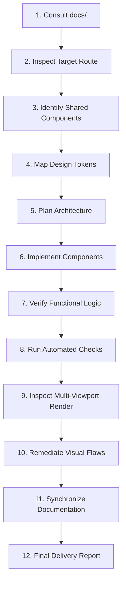

# 12-Step Implementation Workflow

This document establishes the **standard 12-step development lifecycle** for implementing, refactoring, or extending any UI feature on the D1 Store platform.

---

## 1. The 12-Step Workflow



### Step 1: Consult `docs/` Standards
- Open [`docs/README.md`](./README.md) and [`docs/MASTER_UI_UX_RULES.md`](./MASTER_UI_UX_RULES.md).
- Identify the specific guideline document governing your task (e.g. [`docs/PRODUCT_PAGE_STANDARDS.md`](./PRODUCT_PAGE_STANDARDS.md)).
- Review [`docs/PROHIBITED_UI_PATTERNS.md`](./PROHIBITED_UI_PATTERNS.md) to ensure awareness of banned patterns.

### Step 2: Inspect Target Route & Existing Code
- Read the existing route file in `frontend/src/app/`.
- Inspect existing prop types in `frontend/src/types/index.ts`.
- Check connected backend endpoints in `frontend/src/lib/api.ts` and `backend/src/routes/`.

### Step 3: Identify Shared Components & Primitives
- Check `frontend/src/components/ui/` for existing primitives (`button.tsx`, `input.tsx`, `dialog.tsx`, `tabs.tsx`, `card.tsx`).
- Reuse established primitives rather than constructing ad-hoc HTML controls.

### Step 4: Map Design Tokens
- Select colors, spacing, radii, and shadows from [`docs/DESIGN_SYSTEM.md`](./DESIGN_SYSTEM.md).
- Use Figtree for headings and Inter for body copy.
- Enforce standard component heights (48px for buttons and inputs).

### Step 5: Plan Architecture & Modular Decomposition
- If the feature requires more than 300 lines of JSX, decompose it into single-responsibility subcomponents inside `frontend/src/components/[domain]/`.
- Determine Server vs Client Component boundaries (`page.tsx` for SSR/SEO, `*Client.tsx` for interactivity).

### Step 6: Implement Using Standard Conventions
- Code components strictly adhering to [`docs/CODING_CONVENTIONS.md`](./CODING_CONVENTIONS.md).
- Merge classes using the `cn()` utility.
- Ensure all interactive elements include visible focus rings and accessible labels.

### Step 7: Verify Functional Logic
- Test interactive flows: variant switching, cart additions (`useCart`), checkout form steps, API submissions.
- Confirm state changes persist accurately without page reloads.

### Step 8: Run Automated Tooling Checks
Execute the strict project verification commands:
```bash
# Frontend TypeScript validation
npx --prefix frontend tsc --project frontend/tsconfig.json --noEmit

# Backend TypeScript validation
npm --prefix backend run lint

# Production buildability check
npm --prefix frontend run build
```

### Step 9: Inspect Actual Rendered Output
- Ensure the dev servers are running on port `3000` and `5000`.
- Verify the rendered HTML and computed styles across the 8 standard viewports (1920px, 1440px, 1280px, 1024px, 768px, 430px, 390px, 360px).

### Step 10: Remediate Visual Flaws & Anti-Patterns
- Audit computed typography: Confirm zero primary text `< 14px`.
- Confirm touch targets are at least 44×44px.
- Confirm zero horizontal body scroll on mobile.

### Step 11: Synchronize Documentation
- If a new reusable token, subcomponent, or route was introduced, document it in [`docs/DESIGN_SYSTEM.md`](./DESIGN_SYSTEM.md) or [`docs/PROJECT_OVERVIEW.md`](./PROJECT_OVERVIEW.md).

### Step 12: Final Delivery Report
- Prepare a structured summary for the user covering:
  - Files created or modified.
  - Architectural decisions made.
  - Visual QA results across desktop, tablet, and mobile.
  - Confirmation of zero introduced anti-patterns.
