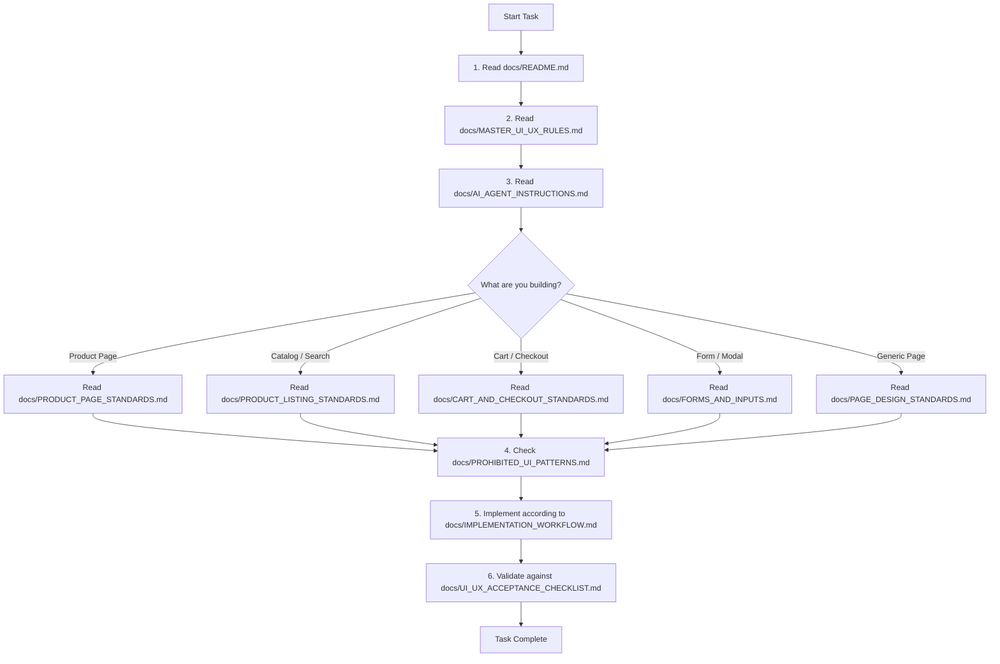

# D1 Store E-Commerce UI/UX Standards & Development Documentation

Welcome to the definitive UI/UX, responsive design, component sizing, and frontend engineering documentation system for the **D1 Store** e-commerce platform.

This documentation serves as the **permanent single source of truth** for human engineers, design reviewers, and AI coding agents. It establishes strict rules and architectural standards to ensure every page, component, and interaction is readable, properly proportioned, accessible, visually balanced, and robust across all device form factors.

---

## 1. Purpose of This Documentation System

Historical development cycles and autonomous AI agent tasks frequently introduced subtle but severe UI/UX regressions:
- **Tiny, unreadable text** (`text-[10px]`, `text-[11px]`, or `text-xs`) used inappropriately for primary labels, values, and buttons.
- **Undersized interactive controls** (buttons and inputs under 40px tall, sub-44px touch targets).
- **Unbalanced layouts** (excessive empty margins beside compressed content columns, or rigid narrow containers on ultra-wide viewports).
- **Arbitrary visual tokens** (inconsistent padding, mismatched border radii, conflicting font sizes across neighboring routes).
- **Destructive mobile adaptations** (shrinking element scales rather than reflowing layout columns).

**This system permanently solves these regressions by codifying mandatory standards, component tokens, forbidden patterns, and a visual QA protocol.**

---

## 2. Master Documentation Directory & Index

Every file in this system has a specific, non-overlapping responsibility. All links below use relative Markdown paths.

| File | Purpose & Core Contents | Authority Level |
|:---|:---|:---:|
| [`README.md`](./README.md) | **System Entrypoint & Navigation Index**: Architecture summary, reading order, conflict resolution rules. | Meta |
| [`PROJECT_OVERVIEW.md`](./PROJECT_OVERVIEW.md) | **Current Repository Ground Truth**: Actual stack (Next.js 16, React 19, Tailwind 4, Express 5), route map, components. | Informational |
| [`MASTER_UI_UX_RULES.md`](./MASTER_UI_UX_RULES.md) | **Universal Invariant Laws**: Non-negotiable readability, sizing, layout balance, and proportionality rules. | **Highest** |
| [`DESIGN_SYSTEM.md`](./DESIGN_SYSTEM.md) | **Authoritative Token Specifications**: Color palette, spacing scale, radius, shadows, typography tokens, status states. | **Authoritative** (Tokens) |
| [`TYPOGRAPHY_STANDARDS.md`](./TYPOGRAPHY_STANDARDS.md) | **Typography Scale & Font Rules**: Figtree & Inter pairing, responsive font sizes, line heights, forbidden sizes. | **Authoritative** (Text) |
| [`SPACING_AND_LAYOUT.md`](./SPACING_AND_LAYOUT.md) | **Layout Containers & Spatial Rhythm**: Max widths (1280px, 1400px, 1760px), section vertical rhythm, padding standards. | Standard |
| [`COMPONENT_SIZING_STANDARDS.md`](./COMPONENT_SIZING_STANDARDS.md) | **Element Dimensions & Touch Targets**: Mandatory button heights (44–50px), input dimensions, card padding. | Standard |
| [`RESPONSIVE_DESIGN.md`](./RESPONSIVE_DESIGN.md) | **Multi-Device Breakpoint Strategy**: 360px, 390px, 430px, 768px, 1024px, 1280px, 1440px, 1920px reflow specifications. | Standard |
| [`PAGE_DESIGN_STANDARDS.md`](./PAGE_DESIGN_STANDARDS.md) | **Universal Page Structure**: Header positioning, breadcrumb conventions, content hierarchies, footers. | Standard |
| [`PRODUCT_PAGE_STANDARDS.md`](./PRODUCT_PAGE_STANDARDS.md) | **Product Detail Page (PDP) System**: Mandatory 5-section sequence, gallery, purchase panel, sticky sub-nav. | Page Spec |
| [`PRODUCT_LISTING_STANDARDS.md`](./PRODUCT_LISTING_STANDARDS.md) | **Collection & Search Pages (PLP)**: Product card specs, responsive column counts, filter sticky bar, sorting. | Page Spec |
| [`CART_AND_CHECKOUT_STANDARDS.md`](./CART_AND_CHECKOUT_STANDARDS.md) | **Cart & Checkout Architecture**: Dual-column 1280px checkout layout, order summary, form rhythm, trust badges. | Page Spec |
| [`FORMS_AND_INPUTS.md`](./FORMS_AND_INPUTS.md) | **Forms, Fields & Form Validation**: Accessible labels, 44–50px input targets, error states, Radix primitives. | Component Spec |
| [`TABLES_AND_DATA_DISPLAY.md`](./TABLES_AND_DATA_DISPLAY.md) | **Tables, Matrices & Tech Specs**: Specification accordion tables, review distribution charts, mobile cards. | Component Spec |
| [`ICONS_AND_INTERACTIONS.md`](./ICONS_AND_INTERACTIONS.md) | **Lucide Icons & Micro-Interactions**: Icon stroke weights, bounding box sizes, hover/focus rings, motion tokens. | Component Spec |
| [`ACCESSIBILITY_STANDARDS.md`](./ACCESSIBILITY_STANDARDS.md) | **WCAG 2.2 AA Compliance**: 4.5:1 text contrast, visible focus rings, ARIA conventions, keyboard navigation. | Mandatory |
| [`FRONTEND_ARCHITECTURE.md`](./FRONTEND_ARCHITECTURE.md) | **Codebase Architecture & Boundaries**: Server vs Client Components, API client layer, state providers. | Architectural |
| [`CODING_CONVENTIONS.md`](./CODING_CONVENTIONS.md) | **TypeScript & Style Guidelines**: Strict typing, component prop interfaces, Tailwind class structuring. | Engineering |
| [`PERFORMANCE_AND_SEO.md`](./PERFORMANCE_AND_SEO.md) | **Web Vitals & SEO Protocol**: Core Web Vitals (LCP, CLS, INP), JSON-LD schema, Next.js metadata. | Quality |
| [`TESTING_AND_VISUAL_QA.md`](./TESTING_AND_VISUAL_QA.md) | **Visual Inspection & Verification**: Mandatory rendered browser checks, build commands, viewport testing. | Process |
| [`PROHIBITED_UI_PATTERNS.md`](./PROHIBITED_UI_PATTERNS.md) | **Explicit Anti-Patterns & Banned Code**: Comprehensive breakdown of what NOT to build, with rationales & fixes. | **Enforcement** |
| [`AI_AGENT_INSTRUCTIONS.md`](./AI_AGENT_INSTRUCTIONS.md) | **Direct Instructions for AI Agents**: Strict behavior instructions, workflow requirements, and exit criteria. | Meta / AI |
| [`IMPLEMENTATION_WORKFLOW.md`](./IMPLEMENTATION_WORKFLOW.md) | **12-Step Implementation Process**: From requirement reading to browser QA and delivery reporting. | Process |
| [`UI_UX_ACCEPTANCE_CHECKLIST.md`](./UI_UX_ACCEPTANCE_CHECKLIST.md) | **Pre-Merge Acceptance Checklist**: 40-point verification checklist required before declaring tasks complete. | Gatekeeper |

---

## 3. Mandatory Reading Order for Developers and AI Agents

Before writing or modifying a single line of frontend code, every engineer or AI coding agent **MUST** follow this reading sequence:

1. **Step 1: Universal Rules**
   - Read [`MASTER_UI_UX_RULES.md`](./MASTER_UI_UX_RULES.md) to understand non-negotiable size, font, and layout baselines.
   - Read [`AI_AGENT_INSTRUCTIONS.md`](./AI_AGENT_INSTRUCTIONS.md) (if operating as an AI agent) to absorb workflow rules and constraints.
2. **Step 2: Specific Scope Document**
   - Consult the target document corresponding to the feature (e.g., [`PRODUCT_PAGE_STANDARDS.md`](./PRODUCT_PAGE_STANDARDS.md) for PDP, [`CART_AND_CHECKOUT_STANDARDS.md`](./CART_AND_CHECKOUT_STANDARDS.md) for checkout).
3. **Step 3: Tokens & Primitives**
   - Check [`DESIGN_SYSTEM.md`](./DESIGN_SYSTEM.md) and [`TYPOGRAPHY_STANDARDS.md`](./TYPOGRAPHY_STANDARDS.md) to select verified design tokens.
4. **Step 4: Anti-Pattern Check**
   - Review [`PROHIBITED_UI_PATTERNS.md`](./PROHIBITED_UI_PATTERNS.md) to ensure your planned solution does not introduce banned patterns.
5. **Step 5: Verification & Checklist**
   - Execute [`TESTING_AND_VISUAL_QA.md`](./TESTING_AND_VISUAL_QA.md) and pass [`UI_UX_ACCEPTANCE_CHECKLIST.md`](./UI_UX_ACCEPTANCE_CHECKLIST.md).

---

## 4. Conflict Resolution & Precedence Hierarchy

When two documentation files or guidelines appear to conflict, use this **strict hierarchy of authority**:

1. **`MASTER_UI_UX_RULES.md` overrides all other documents** on questions of core readability, minimum touch target sizes, minimum typography sizes, and layout balance.
2. **`DESIGN_SYSTEM.md` is authoritative for token values** (colors, spacing values, radius variables, shadow definitions).
3. **`TYPOGRAPHY_STANDARDS.md` is authoritative for font sizes, font weights, and line heights**.
4. **Page-specific documents (`PRODUCT_PAGE_STANDARDS.md`, `CART_AND_CHECKOUT_STANDARDS.md`, etc.)** govern layout flow, section ordering, and business components within their respective domains, but cannot override master readability or sizing minimums.
5. **`PROJECT_OVERVIEW.md` reflects existing reality**, but does not justify continuing a known UI/UX regression or anti-pattern.

---

## 5. Maintenance & Updating Standards

As the platform evolves:
1. **Never create conflicting ad-hoc tokens**: If a new component requires a unique size, add a formalized proposal to [`DESIGN_SYSTEM.md`](./DESIGN_SYSTEM.md) with explicit rationale.
2. **Clearly distinguish Proposed vs Implemented**:
   - `[IMPLEMENTED]` marks tokens and rules active in `globals.css` or Tailwind configuration.
   - `[PROPOSED]` marks targeted standards that are being phased into the codebase during refactoring.
3. **Keep `README.md` updated**: If a new architectural document is added to `docs/`, register it in this index immediately.
