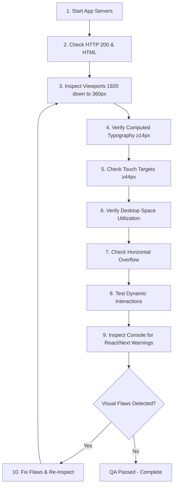

# Testing & Visual QA Protocol

This document establishes the **mandatory visual quality assurance (QA) procedure** that every developer and AI coding agent must execute before declaring any UI task complete.

---

## 1. The Cardinal QA Principle

> **RULE**: A clean TypeScript build or passing linter is **NECESSARY BUT NOT SUFFICIENT** proof of completion. Code that compiles with zero errors can still render tiny unreadable text, misaligned columns, or broken layouts. Every user-facing change must be verified against actual rendered browser output.

---

## 2. Mandatory 10-Step Visual Verification Procedure

Whenever modifying or implementing a frontend page or component:



1. **Step 1: Run Application Services**
   - Ensure backend API is active on port `5000` (`npm --prefix backend run dev`).
   - Ensure frontend Next.js dev server is active on port `3000` (`npm --prefix frontend run dev`).
2. **Step 2: Inspect Rendered HTML Payload**
   - Verify the route returns HTTP status `200 OK` and contains expected landmark DOM IDs (`#overview`, `#in-the-box`, `#specifications`, `#faqs`, `#reviews`).
3. **Step 3: Multi-Viewport Inspection**
   - Inspect the interface at:
     - **1920px** (Desktop wide)
     - **1440px** (Desktop standard)
     - **1024px** (Tablet landscape)
     - **768px** (Tablet portrait)
     - **390px** (Mobile standard)
4. **Step 4: Verify Typography & Font Sizes**
   - Check computed font sizes:
     - No body paragraph `< 14px`.
     - No main heading `< 24px`.
     - Mobile input fields must be exactly `16px` or larger.
5. **Step 5: Verify Interactive Component Heights**
   - Confirm primary action buttons are between **46px and 50px** high.
   - Confirm input fields are between **46px and 50px** high.
   - Confirm icon triggers have bounding boxes of at least **40×40px** (desktop) or **44×44px** (mobile).
6. **Step 6: Audit Space Utilization (Desktop Balance)**
   - Check that the page does not render inside a narrow centered corridor leaving giant empty oceans on desktop monitors.
7. **Step 7: Audit Horizontal Overflow**
   - Confirm the document does not introduce horizontal scrolling on mobile viewports (`document.documentElement.scrollWidth <= window.innerWidth`).
8. **Step 8: Test Interactive User Journeys**
   - Click variant pills: Verify price, image, and SKU update in real time.
   - Click "Add to Cart": Verify item appears in `useCart` with correct variant data and subtotal.
   - Open dialogs / Lightbox: Verify focus trap, `Esc` closing, and background lock.
9. **Step 9: Audit Browser Console**
   - Check for React key warnings, hydration mismatches, or unhandled promise rejections.
10. **Step 10: Remediate & Re-verify**
    - Correct any identified visual or interactive flaws before submitting or completing the task.

---

## 3. Project Validation Scripts & Commands

Always run these automated verification commands as part of the quality gate:

```bash
# 1. Type-check frontend without compilation
npx --prefix frontend tsc --project frontend/tsconfig.json --noEmit

# 2. Type-check backend
npm --prefix backend run lint

# 3. Verify Next.js production buildability
npm --prefix frontend run build
```

---

## 4. Visual Inspection Checklist Summary

Before declaring any frontend task complete, answer these questions:
- [ ] Is all text instantly readable without zooming?
- [ ] Are all buttons and inputs comfortable to click and tap?
- [ ] Does the page make effective use of widescreen displays?
- [ ] Does the layout adapt by stacking rather than shrinking on mobile?
- [ ] Are empty and loading states present and polished?
- [ ] Have you tested the actual rendered page in a browser?
